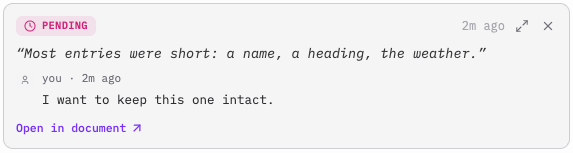

# 1.9.0 editor-state QA — one section per PR

Run in the **dev window** (`qa/dev` = `release/v1.9.0` at `9699d4b` plus the PR under test), never the installed Prose. Tick here; the ticks get replayed into the qa/ PR by index. Findings go in a blockquote under the box, as before.

## 1 · PR #1165 (#1145) — per-tab document sessions, 2026-11-01

What changed underneath: every open tab now keeps its own editor state, and a tab switch swaps that state into the view instead of re-parsing the markdown. Comments, AI highlights and pending suggestions load and save only through that layer, under the tab's own id. Every open, switch, close, rename, Save As, convert and reload goes through one implementation.

**How to tell you are in the right build:** ⌘O opens the picked file in a **new tab** and leaves the current one open. If it replaces the document in place, that is the installed app, not the dev window.

**Use fresh documents for this section.** The two "Hello world" files from §G carry contaminated records in the dev profile from the old bug and would confuse the read-out. Two new files in any folder are enough, five or six paragraphs each. (Say the word and I clear the two old keys.)

### 1.1 Two documents, twenty switches, relaunch

- [x] **Seed both.** In doc A: select a phrase, add a comment; ask the chat to tighten one paragraph and accept the suggestion so the paragraph carries an AI highlight. Same in doc B. Each doc shows its own comment and highlight, nothing from the other.

- [x] **Twenty switches.** Alternate A → B → A ten times, using the tab bar for some and the explorer for others. On every visit type a few words somewhere outside the marked text. After the last switch: each doc still shows exactly its own comment and its own highlight on the AI's words; the caret and scroll come back where you left them; nothing was marked resolved; each comment panel lists only its own thread.

- [x] **Edit above a highlight, then switch.** In A, click at the end of a paragraph above the highlight, Backspace the last word leaving a trailing space, switch to B and back. The highlight still covers the AI's words exactly (the §G case).

- [x] **Relaunch.** Save both, ⌘Q the dev window and tell me; I restart the server. Both tabs come back, the one you left active is active, each with its comment and highlight; the caret is roughly where it was.

### 1.2 Source mode round trip

- [x] **Edit in source, come back.** In A (comment and highlight present), ⌘⇧E into source mode, change a word in a line **above** the marked text and add a new paragraph at the top, ⌘⇧E back. Comment and highlight sit on the same words. One ⌘Z removes the whole source edit at once; ⌘⇧Z brings it back with the marks intact.

- [x] **Untouched toggle.** ⌘S, then ⌘⇧E in and straight back out without typing. No dirty dot appears.

- [x] **Switch while in source mode.** ⌘⇧E into source in A, type a line, click tab B, come back to A. A is in rich mode and shows the line you typed.

### 1.3 Identity changes: rename, Save As, convert

- [x] **Rename from the tab.** Double-click A's tab title, give it a new name, Enter. Tab title, explorer entry and window title agree; the old file is gone from the folder; comment and highlight still there; type, ⌘S, the new file has the text.

- [x] **Rename from the explorer.** Rename B with the explorer's rename. Same expectations; the tab follows without a reload flash.

- [ ] **Save As.** In A, ⌘⇧S to a new name. The tab now shows the new name; comment and highlight came along; the original file still holds the pre-Save-As text.

  > a. The keyboard shortcut doesn't seem to work; b. I could be wrong, feel free to push back, but the behavior is somewhat confusion. I triggered Save As via the menu, and it worked, but the way it worked was by having the new "Saved As" document assume the current tab, rather than create/open a new file as the result of the Save As. Open to push back, but I think we should anchor on whatever is standard across IDEs or other text editors.

- [x] **Convert to .txt and back.** File → Convert to Plain Text on B, then File → Convert to Markdown. After the first: the tab is plain text (no formatting rendered, `.txt` in the title) and the `.md` is gone from the folder. After the second: markdown renders again. The comment follows both ways, or shows in the panel as unanchored if its text no longer matches; it does not vanish.

### 1.4 Preview, close, reopen

- [x] **Preview browsing.** Single-click a file in the explorer (italic preview tab), then ↑/↓ through five or six files. One preview tab is reused; each file's content shows; the chat panel is hidden while the preview tab exists; double-click the tab or type in it: the title goes upright and the chat panel is back. Click the same already-open file three times in a row: no frontmatter flicker, no read-only flip.

- [x] **Close the active tab among three.** Open a third doc C, make A active, ⌘W it (save if asked). The tab that becomes active shows its own text, comment and highlight, and its dirty state is unchanged. Then ⌘⇧T: A is back with its comment and highlight.

- [x] **Reopen from the explorer.** Close B, open it again from the explorer. Comment and highlight restored; what you see is what is on disk.

### 1.5 The file moves under an open tab

- [x] **Trash an open file.** Right-click C in the explorer → Move to Trash → confirm. C's tab closes; A and B are untouched and still save.

- [x] **Move an open file.** Drag B into another folder (or cut and paste it in the explorer). The tab's path follows (Show in Folder on the tab); type and ⌘S writes to the new location, nothing reappears at the old one; comment and highlight stay.

### 1.6 Chat still sees the document

- [x] **Fresh text, right tab.** Type a distinctive word at the end of A and immediately ask the chat "what is the last word of the document?". It answers with the word you just typed. Ask it to suggest an edit: the suggestion marks land in A, accepting one leaves an AI highlight in A, and B shows none of it.

### 1.7 Byte-exact save (I check this one)

- [x] **Untouched round trip.** Open a markdown file from a git repo that has unusual formatting (`*` bullets, a table, trailing spaces). Switch away and back, toggle source mode in and out, ⌘S. Tell me which file; I run `git diff` on it and expect no change.

  > \~/Code/Projects/prose/docs/qa/[467-agent-persona.md](http://467-agent-persona.md)

  > Checked 2026-11-02: `git diff` empty, and the file was never rewritten (mtime unchanged), because nothing was dirty after the switch and the untouched toggle.

Once these hold, PR #1165 merges onto `release/v1.9.0` and `qa/dev` resets to the release head. PR 2 of the series (AI annotations in plugin state) follows.

## Misc

1. ***Important***\*:\* It doesn't appear that AI annotations are showing up at all after accepting a suggestion.
2. Suggestion modal doesn't stay pinned to where the annotation is, like comments, but rather remains visible in the window while scrolling.
3. Source mode doesn't remain selected after a tab switch.
4. Re: 1.2.3, this works, but I don't like the behavior. I'd prefer it stay on source mode if that's what you left on, and on top of that, it would be cool if toggling between source and WYSIWYG kept your carat on the same spot, but that's all better as follow-up imo.
5. Try to drag move a file *up* a directory (currently represented a `^ ..`) doesn't work.
6. CMD X in one directory and then CMD V (or the UI based equivalents via right click) don't seem to be working eitehr.

## Misc triage (2026-11-02)

1. **Regression from PR #1165, fixed on the branch:** a suggestion made before a rename, Save As or first save carried the old document id, and the new store refused the annotation on accept. Both accept paths and the tool executors now stamp the live document id; sessions spec case 7 covers it. Re-tested by the operator in the dev window on `9a868a8` (2026-11-02): fixed.
2. Pre-existing, filed as #1168 (popover measured once at open, `position: fixed`).
3. and 4. Source mode per tab is #1132 → PR 6 (#1150), your preference recorded there; caret continuity across the toggle filed as #1170.
4. Pre-existing, filed as #1167 (the `..` row has no drop handler; the list's drop moves into the current folder).
5. Pre-existing, filed as #1166 (`pasteFile()` is called without a target folder, so a cut pastes into its own folder).

Save As: the shortcut is #1169 (TipTap's strikethrough binds ⌘⇧S and swallows it before the menu sees it). The semantics stay: VS Code, Sublime, BBEdit and TextEdit re-point the current tab or window to the new file and leave the original on disk, which is what Prose does.

## 2 · PR #1171 (#1146) — AI highlights live with the document, 2026-11-03

What changed underneath: the AI highlight records (the Activity entries) now live inside each tab's own editor state instead of a global store. They are written the moment an edit creates them, they carry the text under them, and they are put back on that text whenever the document is re-parsed (relaunch, disk reload, convert) or replaced whole (leaving source mode, and undoing that). A and B from §1 are fine for this section, or any two documents.

### 2.1 Highlights survive a re-parse

- [x] **Edit above, relaunch.** In A, ask the chat to rewrite one paragraph and accept it, so it carries a highlight. Click at the end of a paragraph **above** it, Backspace the last word leaving a trailing space, ⌘S. ⌘Q the dev window and tell me; I restart. The highlight comes back on exactly the AI's words (before this PR it sat one character to the left after a relaunch).

- [x] **Disk change.** With A open and its highlight in place, edit the file in another app: delete a word in a paragraph above the highlight and save. Back in Prose, take the reload when it asks. The highlight is on its words.

- [x] **Convert and back.** Convert A to `.txt` and back to `.md` (File menu). The highlight is still on its words each time.

### 2.2 Source mode and undo

- [x] **Source exit, then undo.** ⌘⇧E into source, type at the end of a line **below** the highlight, ⌘⇧E out: highlight on its words. One ⌘Z: the typed text is gone and the highlight is still painted on its words. ⌘⇧Z: the text is back, highlight still painted.

### 2.3 Activity panel and the toggles

- [x] **Panel follows the tab.** Open the Activity tab in the chat sidebar. Switch A → B → A: the list shows only the active document's entries each time, never the other's.

- [x] **Remove.** Hover an entry, click its X. The highlight leaves the text and the entry leaves the list; after a relaunch it is still gone.

- [x] **Jump.** Click an entry's crosshair: the caret lands on its words. A superseded (dimmed) entry does nothing.

- [x] **Mark and unmark as AI.** Select plain text, use the selection toolbar's AI toggle: a highlight appears. Toggle again: gone. Select the first half of an existing highlight and toggle: only the second half remains.

- [x] **Paste as AI.** Paste a sizable chunk of text and answer Yes to "mark as AI-authored": the pasted text is highlighted and listed.

### 2.4 Deletions and renames

- [x] **AI deletion marker.** Ask the chat to delete a paragraph and accept. The Activity list shows an "AI Deletion" entry that stays current (not dimmed) while you type elsewhere; its crosshair puts the caret where the paragraph was.

- [x] **Rename with highlights.** Rename A from the tab, type, ⌘S, relaunch: the highlights and the Activity entries are still there under the new name.

## Misc

1. Interesting new behavior on `.txt` files:
   1. Text styling menubar is visible but the buttons don't do anything. We should hide those, but...
   2. Commenting and AI edit annotations persist, which, I guess is ok, so we should probably keep that, eh?
   3. This makes me think we should have a separate `.txt` follow up to shore that behavior up and make sure AI suggestions, comments, etc. all work properly on `.txt` files

## Misc triage (2026-11-03)

* **Accepting a suggestion over an existing highlight chopped it per word with duplicate Activity entries.** That was #677's carry-over of a prior annotation onto its unchanged words, one record per word labelled with the parent's whole text, unchanged since the store days; fixed in PR #1171 (adjacent surviving words become one record that keeps the parent's id and time, labelled with the text it covers). Re-test: accept a suggestion that rewrites one word of an already-highlighted sentence; the rest of the sentence stays one highlight and one entry.
* `.txt` **notes 1–3** → #1172 (hide the inert formatting controls in plain mode; keep comments and annotations on `.txt`, as wanted; verify suggestions on a plain document with a spec). Board Do Next, not on the 1.9.0 critical path.

## 3 · PR #1173 (#1147) — comment threads live with the document, 2026-11-03

What changed underneath: comment threads (replies, resolved state, share ids) now live inside each tab's own editor state, next to the comment marks, instead of a global store mirrored from the active tab. Every change to a thread is one transaction on its document, written at once; share pushes (new thread, reply, resolve, delete) are addressed to the document that owns the thread, so a tab switch mid-push changes nothing; a share pull merges into a document open in a background tab as well as the active one. Behaviour changes to notice: undoing a resolve (or undoing the deletion that auto-resolved a thread) reopens the thread; a reviewer's deleted thread takes its highlight with it on the next pull; `list_comments` now tells the model about open threads whose text was edited away. A and B from §1 are fine, or any two documents.

### 3.1 Threads follow the tab

- [x] **Add, reply, switch.** In A, select a sentence and add a comment; reply to it from the popover. Switch to B, add a comment there. Switch back: A shows its thread with the reply, B's is nowhere in A. The status bar count and the chat chip count match the open threads of whichever tab is active.

- [x] **Relaunch.** ⌘Q and tell me; I restart. Both documents still carry their threads on the right text, with the reply.

### 3.2 Resolve, reopen, delete

- [x] **Resolve and reopen.** Resolve A's thread from the popover: the highlight goes, the Activity panel files it under resolved. Reopen it from the Activity panel's resolved entry (or the popover): the highlight is back on the same words.

- [x] **Delete the text, then undo.** Select a commented sentence entirely and delete it: the thread resolves itself (count drops, Activity shows it resolved). ⌘Z: the text and the highlight are back and the thread is open again (before this PR it stayed resolved and its highlight vanished at the next relaunch).

- [x] **Delete the thread.** From the popover's trash icon: highlight and thread gone, still gone after a relaunch.

### 3.3 The model and the review panel

- [x] **Chat processes a thread.** Add a comment asking for a change, click Process in the popover (or "Review comments" in the chat chip): the model replies and/or resolves through its tools, and the reply shows in the thread.

- [x] **AI edit over a comment.** With a commented sentence, ask the chat to rewrite that paragraph and accept. The thread stays open (not resolved), shown as anchor-lost in Comment Review; ⌘Z puts the highlight back.

- [x] **Comment Review panel.** Enter Comment Review from the status bar count; resolve one thread with the swipe or ↵, reply to another with ⌘↵. Both land in the Activity panel and survive a tab switch.

### 3.4 Source mode, rename, shared documents

- [x] **Source round trip.** ⌘⇧E into source, type elsewhere, ⌘⇧E out: the thread's highlight is on its words. Edit the commented sentence itself in source and exit: the thread is anchor-lost (open, no highlight), not resolved.

- [x] **Rename.** Rename A from the tab bar, relaunch: threads intact under the new name.

- [x] **Shared document, if you have a share handy.** On a published document: add a comment, reply, resolve, reopen, delete. Each reaches the shared page as before (the pushes now name the document, not "the active tab"). Open the shared document in a background tab (another tab active), let the 60 s pull run or open the share popover from the other tab: nothing changes until you switch to the shared document, which then shows the reviewer's thread without a reload.

## 4 · PR #1174 (#1148) — a chat turn stays with its document, 2026-11-03

What changed underneath: a chat turn is bound to the document its conversation belongs to. Every tool call the model makes acts on that document even when another tab is in front (a background tab takes the change in one step, no streaming), the stream keeps appending to that conversation and shows when its tab is active again, and the streaming state (the caret, the disabled input, Stop) is the active conversation's only. A tab closed mid-turn comes back in the background from disk; an untitled one makes the rest of the turn fail with a message naming it. A tool that opens or switches to another document (create a file, open a file, select a tab) moves the turn and its conversation to that document. Also: `read_document` now reads the live state (not the half-second-old mirror), and a rename keeps the conversation's autosave key straight. A and B from §1 are fine, or any two documents.

### 4.1 Switch away mid-turn

- [x] **Edit lands on the right document.** In A, ask the chat to rewrite two paragraphs (something that takes a few seconds). As soon as the first edit appears, click B's tab. Watch B: nothing changes in it, its chat shows B's own conversation (or none), its input is not disabled, and the Stop button is not shown. Click back to A: both paragraphs are rewritten with highlights, and the chat shows the finished turn with its tool-result chips.

- [x] **Two turns at once.** While a long turn runs on A, switch to B and ask B's chat something that edits B. Both finish on their own documents; each panel shows its own stream when active.

- [x] **Stop is per document.** Start a turn on A, switch to B, start one on B, press Stop on B: B's turn stops, A's finishes.

### 4.2 Close mid-turn

- [x] **Saved document.** Start a turn on A (saved to disk, ⌘S first). Mid-turn, close A's tab and choose Discard. The tab reappears in the tab bar (not active) once the turn continues; click it: the later edits are there with highlights (the discarded early edits are not, they were discarded).

- [x] **Untitled document.** New untitled document, type a few paragraphs, start a turn, close the tab mid-turn (Discard). Nothing lands anywhere else; the other tabs are untouched.

### 4.3 Create a file from the chat

- [x] **Create and keep writing.** In A, ask the chat: "Create a new document called Notes with an outline, then add a closing paragraph." The new file opens, the outline and the closing paragraph land in it (not in A), and the chat panel on the new file shows this conversation continuing.

### 4.4 Reads, renames, source mode

- [x] **Fresh reads.** Ask the chat to rewrite a paragraph and then, in the same request, summarise the document. The summary reflects the rewritten text.

- [x] **Rename mid-turn.** Start a turn on A; while it runs, rename A from the tab bar. The turn finishes on the renamed document, and after a relaunch the conversation is under the new name.

- [x] **Source mode refuses writes.** Enter source mode on A (⌘⇧E) and ask the chat to edit: the model is told the document is in source mode; nothing changes. Exit source mode: edits work again.

## 5 · PR #1176 (#1150) — source mode stays with its tab, 2026-11-03

What changed underneath: source mode is per tab. Each tab in source mode keeps its own CodeMirror state (text, caret, folds, source undo history) on its session, so switching tabs and coming back lands you where you were, and the mode survives a relaunch. Leaving source mode with changes is still one undo step that keeps highlights and comments on their text; leaving without changes writes nothing. Closing a tab in source mode (even one that is not in front), reloading it from disk or converting it writes the typed text back first. While a tab is in source mode the keyboard shortcuts that edit the rich document (⌘L, ⌘D, ⌘/, Alt+↑/↓, ⌘U, ⌘⇧X, ⌘⇧F, ⌘K, ⌘⇧⌫, ⌘⇧A) are inert, and the chat's edit tools are refused for that tab. A theme or font change keeps your place. A and B from §1 are fine, or any two documents.

### 5.1 Source mode follows the tab

- [x] **Switch and return.** In A, ⌘⇧E into source mode, click into the middle of a line, fold a heading with the gutter chevron. Click B's tab (B shows its rich editor), then A's tab: A is still in source mode with the caret where you left it and the fold still folded. ⌘⇧E out without typing: the document is not marked dirty.

- [x] **Both tabs in source.** With A in source mode, switch to B and put B in source mode too. Switch back and forth: each shows its own source text and caret.

- [x] **Relaunch.** Leave A in source mode, ⌘Q, tell me, I restart. A opens in source mode (the caret starts at the top after a relaunch; the fold state and source undo are not kept across a relaunch).

### 5.2 Exit, undo and the annotations

- [x] **Edit and exit.** In A (source mode), type at the end of a paragraph that has no highlight, ⌘⇧E out: the text is there; highlights and comments elsewhere are on their words. One ⌘Z: the typed text is gone in one step and the highlights and comments are still on their words.

- [x] **Type, switch, exit later.** In A (source mode), type a line, switch to B, come back to A, ⌘⇧E out: the typed line is in the document.

- [x] **Close in source mode.** Put A in source mode, type a line, switch to B, then close A from the tab bar (choose Save if asked). Reopen A (File menu or ⌘⇧T): the typed line is in the file.

- [x] **Save in source mode.** In source mode, type and ⌘S without leaving source mode: the file on disk has the typed text; after ⌘⇧E out the document is not marked dirty.

### 5.3 Guards

- [x] **Shortcuts stay with CodeMirror.** In source mode, select a line and press ⌘D (duplicate line), then ⌘⇧E out: the rich document shows exactly the source text (nothing was duplicated behind your back by the rich editor).

- [x] **Chat tools refused.** With A in source mode, ask the chat to edit A: the model is told the document is in source mode; nothing changes. ⌘⇧E out: the edit tools work again.

- [x] **Theme change.** In source mode with the caret mid-document, switch the theme (Settings → Appearance): the caret and the text stay put.

- [x] **Preview and reMarkable tabs.** The status-bar "WYSIWYG" toggle and View → Toggle Source do nothing on a preview tab (single-click a file in the explorer) or a reMarkable OCR tab.

## 6 · PR #1177 (#1151) — frontmatter on the tab, one dirty rule, autosave from the record, 2026-11-03

What changed underneath: the tab record is now the truth for the document's body, its frontmatter, its unsaved flag, and whether it is a preview or read-only; the editor store only mirrors the tab in front. "Unsaved" means one thing: the body or the frontmatter differs from what the file holds (the load, then every save), so undoing back to the saved text is clean again. Autosave (auto or custom) watches the tab records, one timer per dirty tab: a frontmatter-only edit, an edit typed in source mode, and a chat edit in a background tab all save; switching tabs no longer cancels a pending save, and a save marks the tab it wrote. The frontmatter block is driven by the tab's object; typing into it never loses the row you are on. A document with frontmatter keeps the blank line after the fences and its final newline. A and B from §1, or any two documents, one with frontmatter.

### 6.1 Frontmatter

- [x] **Edit a field.** In a document with frontmatter, click the frontmatter block, change a value: the tab shows the dirty dot at once (autosave off; with autosave on, the dot is hidden as before). Change it back to the original value: the dot goes away without a save.

- [x] **Add a field.** Click "Add field", type a key and a value, press Return twice: the new row stays, nothing you typed is wiped mid-edit. Save, reopen the file: the field is there, keys in the order you see them.

- [x] **Non-text field.** A document whose frontmatter has a list or a date (`tags: [a, b]`, `date: 2026-11-03`): the row shows locked (🔒), the other rows edit normally, and editing another row does not reset the one you are typing in (#1105).

- [x] **AI frontmatter suggestion.** Ask the chat to suggest frontmatter (suggest mode): the overlay appears; Accept: the rows update, the tab is dirty, Reject: nothing changes. Switch tabs with an overlay open and come back: the overlay is gone (unchanged from before).

- [x] **Chat writes frontmatter in a background tab.** With a chat bound to A, switch to B, ask the chat to set A's frontmatter title (create mode, `edit` on the frontmatter): no error; switch to A: the title is there and A is dirty.

### 6.2 Dirty and saves

- [x] **Undo to clean.** Type in a saved document (dot), ⌘Z until the text is back as saved: the dot is gone; a close takes no prompt.

- [x] **Byte-exact frontmatter document.** Open a `.md` whose frontmatter is followed by a blank line and whose body ends with a newline. Change nothing, ⌘S (or edit and undo, then ⌘S): the file's bytes are unchanged (compare in a diff tool or `git diff`).

- [x] **Type during a save.** With a large document, ⌘S and immediately keep typing: the dot comes back (the keystrokes after the save are unsaved), ⌘S again clears it.

- [x] **Source mode save.** In source mode, type a line and ⌘S without leaving source mode: the file holds the typed text; ⌘⇧E out: not dirty.

### 6.3 Autosave

- [x] **Auto mode, frontmatter only.** Settings → autosave Auto. Edit a frontmatter value and stop typing: within about two seconds "saving…" flashes in the status bar and the file on disk has the new value, the body bytes untouched.

- [x] **Auto mode, source mode.** In source mode, edit the title line and wait: the file updates while source mode is still open.

- [x] **Auto mode, switch mid-debounce.** Type in A, switch to B within a second: A still saves (check the file); B is not marked clean by A's save.

- [x] **Custom mode.** Settings → autosave Custom, 10 s. Type in A, switch to B and wait: A saves at the interval even though it is in the background.

- [x] **Missing file.** With autosave on, delete the file of an open tab in Finder, type: the missing-path handling appears as before (no loop of errors), and autosave stops for that path until it is saved elsewhere.

  > It just autosaved the document back to disk, which like, ok fine?

  > Accepted as a pass (operator, 2026-11-04). Same as before PR 7: the "missing path" block only arms when the write itself fails because the folder is gone (`useAutosave.ts` catches `isMissingPathFileError`); trashing the file leaves the folder, so the next autosave rewrites it, exactly as ⌘S would. The expectation above over-specified it.

### 6.4 Preview, read-only, source toggles

- [x] **Preview promotion.** Single-click a file in the explorer (preview tab), click into the editor: the tab becomes permanent and editable; the toolbar's Source button enables at the same moment.

- [x] **Preview, then open for real.** Single-click a file (preview), then double-click the same file: editable, one tab.

- [x] **reMarkable OCR tab.** Open a notebook's OCR document: read-only, Source button disabled, status-bar WYSIWYG toggle does nothing; "Edit" makes an editable copy as before.

- [x] **Source toggles.** Toolbar button, status-bar label, View menu and ⌘⇧E all toggle source mode for the tab in front, and the toolbar button's icon and the status-bar label follow the tab after a switch.

## 7 · PR #1178 (#1152) — seams, tripwires, guidance and the design doc trued up, dead code, 2026-11-03

What changed underneath: test-only seams and spec waits that gated on mechanisms removed in earlier PRs are gone; the repo guidance (`CLAUDE.md`, `AGENTS.md`, `docs/patterns.md`) and the design document now describe the per-tab model as shipped; a few dead exports and the node-ids first-run closure are removed. Two user-visible fixes rode along: `read_selection` no longer answers with another tab's selection, and a comment's share push can no longer be dropped when a paste lands in the same transaction batch. Short pass; A and B from §1.

- [x] **Selection across tabs.** Select a sentence in A, switch to B without selecting anything, ask the chat (or MCP) to read the selection: it reports no selection (not A's sentence). Switch back to A, select again: it reports A's sentence.

- [x] **Rename from the tab bar.** Double-click A's tab title, type a new name, Return: the file is renamed on disk, the tab follows, comments and highlights are still there.

- [x] **Comment push after a paste.** On a shared document in auto sync mode, add a comment, then paste a paragraph: the ◎ popover shows the comment pushed (the web viewer has it).

- [x] **Sanity.** Open, switch, close, reopen (⌘⇧T), source mode toggle, save: nothing regressed from §1–§6.

## Misc

1. The comment that shows that its anchor is lost in comment view shows an "Open in Document" link when seen in the activity panel. This should be consistent.

   

2. Minor: Adding a word inside an annotation in source mode and switching back shows it captured as a part of the annotation. Doing the same in WYSIWYG mode enters it as a human-enter non-annotated entry.

3. Now that edits can land after switching a tab, it'd be cool if we had an activity indicator on the tab icon. This can be the same as the share icon and can temporarily replace the emoji icon. This can also be used for comment notifications via the share feature!

4. Chat panel open state seems to be global, which is probably a mistake given it's document scoped, but that can be a follow-up.

## Misc triage (2026-11-04)

Result of the pass: 81 of 82 boxes ticked on `26eca3e` (the autosave missing-file box above ticked on the accepted note); the one open is Save As (§1.3, the shortcut is #1169, the semantics stay). Nothing blocks the release tail.

1. Anchor-lost thread shows a dead "Open in document" link in the Activity panel while Comment Review says anchor lost → **#1179** (`hasMark = !isResolved` at `AIEditsHistoryPanel.tsx:381`; route it to Comment Review like the share popover does). Quick Wins.
2. Typing inside a highlight in source mode grows it, in rich mode it splits it → **#1180** (`reanchorRecords` uses the diff map that grows, `mapRecords` splits; make the source-exit path split too). Do Next.
3. Activity indicator on a background tab's icon for chat edits and pulled share comments → **#1181** (enhancement). Later.
4. Chat panel open state is one global flag (`chatStore.isPanelOpen`), the preview and review paths already snapshot it per tab → **#1182** (per-tab panel state). Do Next.

None of the four is on the 1.9.0 critical path.
