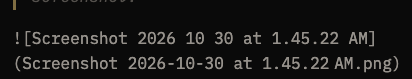
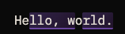

# Prose 1.9.0 — what is left to check

**Build 8** · `~/Applications/Prose QA.app` · About reads **1.9.0**, hash `91f4bca` · release `fed6eb6` + PR #1131 (#1103, three commits).

**Build 7 pass, 2026-10-30:** your blockquotes below are the record. What came of them: the relaunch miss and the comment shift are fixed on the PR (section E re-checks them on build 8); the source-mode return is filed as #1132; the Misc findings are #1133 (image with spaces), #1134 (rails on sidebar resize) and #1135 (Back to activity). The #1102 highlight shift did not reproduce in five orderings, so section E asks for the exact steps.

**Build 8 pass, 2026-10-30:** your two notes in E are both reproduced and filed: **#1137** (comment marks restore onto a different occurrence of the text; Do First, it corrupts the anchor on the next save) and **#1138** (AI highlights slide after a tab switch when an edit above them is normalised by the markdown round trip; Wave 3). Neither comes from #1131, which is green and reviewed and merges on your word.

This is the working list. It replaces the open boxes in `v1.9.0-checklist.md`, which stays as the record. Everything ticked there stays ticked; nothing here needs a second pass unless it says so.

**From 2026-10-31 you test in the dev instance, not a build.** It runs from the spare worktree on the release branch plus whatever has merged since, so a renderer fix reaches your open window seconds after it lands; the window title and About say `Prose Dev`. It has its own profile (`Prose Dev`), so enter the API key once in Settings. Do not click the MCP install there: it would point Claude Desktop at the dev path. The QA build stays installed for section D only, cut once at the end of the train.

Fixture reset when needed: `cp ~/Desktop/qa-polish.orig.md ~/Desktop/qa-polish.md`.

## A · New on build 7 — check now

- [x] About reads `3bd16ee`.

- [x] **The hop (build 6 finding).** Open a document that has frontmatter, click deep into it, switch to another tab and back. The text does not move once it appears, and the frontmatter rows are there on the first frame, not a beat later.

- [x] **#1103, caret and scroll.** In a long document, click somewhere deep, scroll so the caret sits mid-screen, click another tab, click back. The caret is where you left it and the scroll offset is the same.

- [x] Same via the tab shortcut, and via `select_tab` from Claude Desktop if the MCP install is live.

- [x] A tab you have not visited this session still opens at the top.

- [x] Quit and relaunch with the tabs open. The active tab comes back where you left it; the position rides along in the saved session.

  > May be an artifact of the QA build, but that didn't happen.

  Real, not the build: the active tab's view was never captured into the saved session. Fixed on #1131; re-check in E.

- [x] Toggle to source mode on a deep position, switch tabs and back. No crash, and no jump to the top of the rich view on return.

  > So, the behavior I saw is that I switched to source mode, clicked in deep, switched tabs, switched back, and it was in WYSIWYG mode with the cursor at the top.

  By design today (source mode is one global flag, reset on every switch), but the source caret should carry. Filed as **#1132**; this box moves there.

## B · Fixed since the last build you ran — re-check once

**#1102 / #1121 — source mode and AI highlights**

- [x] Have the AI edit a paragraph so it carries a highlight. Toggle to source, type in a *different* paragraph, toggle back. The highlight stays over the same words. Repeat with a fast exit (toggle back within half a second of typing).

- [x] Have the AI insert two or three paragraphs. Toggle to source, type a word into the middle of the first sentence, toggle back. **The highlight stays on all the inserted paragraphs and now includes the new word.** (This is the 14.6 finding; the fix re-anchors through the edit.)

- [x] Same, but type at the very end of the last inserted paragraph. The highlight stays put and does not swallow the new text.

- [x] Same, but delete the whole first inserted sentence. The highlight shrinks to what is left or disappears. It never lands on other text.

- [x] **Comments survive:** add a comment in rich text, toggle to source, edit a *different* line, toggle back. The highlight is still there and the thread is open. Once more with a fast exit.

- [x] **Tabs stay separate:** two documents open, type in source mode in one, switch tabs straight away. The other tab shows its own content. (The old half-second loss on a fast switch is #1127 below, now fixed.)

- [x] **The full round trip:** a document with a heading, list, blockquote and code block. Source mode → edit → back → save → reopen. Content intact. This also closes the cross-cutting sweep's open box.

**#1123 — the AI can see tables**

- [x] In a fresh chat, ask the AI to add a row to a table, without hinting how. It adds the row on the first try: no "I can't", no stray paragraph below the table.

**The three found in 14.6**

- [x] **#1125.** Open a saved document, toggle to source, toggle straight back. No dirty marker, and ⌘W does not ask to save. Then type one character in source mode and toggle back: dirty, as it should be.

- [x] **#1126.** Ask the AI for an edit, dismiss (reject) the suggestion, click another tab, click back. It stays dismissed. Repeat accepting it: the accepted text is there and no suggestion is shown.

- [x] **#1127.** Type a few words and click another tab within half a second. Click back: the words are there. Same with the tab shortcut.

**Wave 1, still open**

- [x] **#1097, rails while typing (§13).** Click into a table cell and type. No grips, no `+` controls while the caret is inside the table.

| Column A | Column B | Column C |
| --- | --- | --- |
| A1 No rails, no controls. | B1 | C1 |
| A2 | B2 | C2 |
| A3 | B3 | C3 |

## C · Outstanding from the main pass — unchanged code, run when convenient

**#1099 (§14.1), three boxes left**

- [x] Comment on **"A closing paragraph to comment on."**, then with tool mode **Full** ask the AI to *suggest* a rewrite and **accept** it. The thread stays **open**, reads *"anchor lost, thread kept"* in Comment Review, and is not under Resolved. Your note about keeping the annotation in the body is filed as **#1122** (Wave 4, after #1119); tick this box on the stated behaviour alone.

- [x] Same with a direct AI **edit** of the commented paragraph. The thread stays open. An edit that only changes words inside the paragraph may keep the highlight on the new text; that is fine.

- [x] If the document is shared: the AI-replaced thread is **not** resolved in the web viewer. The user-deleted one is.

**Cross-cutting sweep**

- [x] Comments: add one, reply, resolve.

**Optional evidence (§12)**

- [ ] On a pre-26 Mac, if one is to hand, the app shows the `.icns` icon rather than nothing. Otherwise `qlmanage -p` on `icon.icns`, or open it in Preview, and say which you did.

**Open question from 14.3.** Did the AI's multi-paragraph edit empty the closing paragraph and leave a trailing `---`? A yes or no is enough; it decides whether a follow-up gets filed.

## D · Runs last — the profile wipe (§9)

These wipe `~/Library/Application Support/Prose QA`, taking the API key, the MCP install and the gateway sign-in with it. Do them after everything above, on the final build of the train.

- [ ] **Fresh install stays silent.** Quit, remove the profile, relaunch. The two first-run dialogs (default `.md` handler, AI consent) over the empty state, and **no release-notes modal**.

- [ ] It still recorded the version: quit and check `lastSeenVersion` is `1.9.0`. If this fails, the concurrent-`loadSettings()` regression is back.

## Retired

* §8's "AI edits still refuse to touch tables" is superseded. #1100 and #1123 made table edits work through the tool layer, and the #1123 box above is the replacement.
* The "About reads hash" boxes for builds 2, 3, 4 and 6: those builds were never run.

## Not yours yet

Each lands as a PR onto `release/v1.9.0` with a build and a short section here.

* #1131 (#1103) merges once section A is clean and the review is in.
* Wave 3 remainder: #1104 frontmatter flicker on explorer clicks · #1105 frontmatter persistence (plus the trailing-newline trim) · #1106 find bar · #885 · #862.
* Wave 4: #1107 pipe escaping · #1119 `edit` streams raw markdown · #1122 comment follows an AI replacement · #1108 input rule · #1109 indented fences · #1110 sup/sub.
* Wave 5: #1111 copy button on code blocks.
* Then: release → `main`, tag `v1.9.0`, roadmap truth-up, release copy. App Store submission stays with you.

## Misc

* Switching tabs seems to have resulted in the inline image render reverting to pure markdown text:\
  

  **#1133.** The saved file name keeps its spaces and markdown cannot parse a destination with spaces, so the next parse falls back to text and the save after that escapes the brackets. Wave 4.

* There's a very slight layout shift coming from the comment when switching tabs.\
  

  Fixed on #1131: the mark's horizontal padding re-wrapped lines when marks restored 100 ms after the load. Re-check in E.

* The table drag handles seem to hold on to their size despite resizes coming for the sidebars expanding or collapsing.

  **#1134.** Only window resize and scroll re-measure; a sidebar toggle is neither. Quick win.

* Back to Activity after resolving all comments doesn't bring you back to the Activity view.

  **#1135.** The button only clears review mode; nothing selects the Activity tab. Quick win.

I'm typing up here to see if the highlights shift.

It shouldn't.

## E · Build 8 — re-check and one question

- [x] About reads `91f4bca`.

- [x] **Relaunch.** Click deep into a document, pause a second, quit, relaunch. The active tab comes back at that caret and scroll.

- [x] **Comment shift.** Add a comment on a paragraph that wraps over several lines, deep in a long document. Switch tabs and back. No text moves when the highlight appears.

  > Crazy regression: The comments are relocating themselves to the same word found elsewhere in the document. This can be observed on this document itself.

  Reproduced and filed as **#1137**. Not from #1131 and not new: the comment is created by counting occurrences in the raw text, but restored by counting them in text with every space removed, so a short word also matches across word boundaries ("that he" contains "the") and the Nth match lands earlier. Dates from the June cross-block fix (#665); the QA pass is the first time a common word was commented in a long document. Worse than it looks: the next save re-derives the anchor from the wrong mark, so it sticks. Do First. This box is only about the layout shift, so tick it on that alone if the text did not move when the highlight appeared.

- [x] **The #1102 highlight.** What exactly happened before the screenshot? The order of the source toggles, the rich-text edits at the top, and whether the highlighted text was an AI *replacement* or an *insert*. A short sequence is enough; I will turn it into a test.

  > I believe it was that the there was an AI annotation on text, then some rich text edits made above that. What I don't recall was the order of operations that led to the shift of the annotation. It was something that had to do with either tab switching, source mode toggling, or both.

  That was enough. Reproduced \[hello world\] and filed as **#1138**: AI highlights \[this isn't AI text\] are stored as positions, and a tab switch re-parses the document from markdown. Any rich-text edit above the highlight that the serializer tidies away (a trailing space after a deletion, a doubled space, an escaped character) shortens the re-parsed text, and the saved positions are applied to it unchanged, so the highlight slides by the difference. A source round trip does not do this, because #1121 re-anchors on source exit; the tab switch has no such step. Long-standing, not from #1131. Wave 3. Tick this box; the question is answered.

## F · In the dev window — #1137 landed, 2026-10-31

The dev window reloaded itself with PR #1140 at 1:14 AM. Nothing else changed.

- [x] **Comment on a short word, deep in a long document.** Pick a word that appears many times above it (`the`, `and`). Switch tabs and back. The highlight is on the word you picked, not an earlier one. Relaunch is not needed; the tab switch is the same restore.

- [x] **Comment across a paragraph break.** Select from the last word of one paragraph into the first word of the next, add a comment, switch tabs and back. The highlight covers exactly what you selected, without a trailing space pulled in.

Once both hold, #1140 merges. Then #1138 (the AI highlight after a tab switch) is next and gets its own section here. **F passed, 2026-10-31.** #1140 merged; the release branch is `01f5489` and the dev window is level with it. Next in the dev window: #1138, the AI highlight after a tab switch, once its spec is proven.

## G · In the dev window — #1138 landed, 2026-10-31

The dev window reloaded itself with PR #1141. AI highlights now carry the text under them and move back onto it when a reload has left them off by a character or two.

- [x] **The edit that used to shift it.** Have the AI edit a paragraph so it carries a highlight. Click at the end of a paragraph **above** it and delete the last word with Backspace, leaving a trailing space. Switch tabs and back. The highlight covers exactly the AI's words.

- [ ] **Same, with a doubled space.** Type two spaces between two words above the highlight instead. Switch tabs and back. Still exact.

  > Spaces disappeared, AI annotation on the paragraph that was edited was intact, but the annotations on the paragraphs below that one were lost. See "Hello world" document currently open.

- [ ] **Relaunch.** Make the trailing-space edit again, wait a couple of seconds, quit the dev window and I restart it. The highlight is where it was.

  > Same behavior as observed above.

- [ ] **Nothing else moved.** Type inside the highlight, type right after it, and delete part of it. It splits, stays put and shrinks the way it did before; a source round trip still keeps it.

  > Holy shit, typing inside the annotation on the second sentence and paragraph brought the annotation back?? That, or reopening the dev server just now somehow restored them. When the restored I was typing right here and the tab switched over mid-type to the other Hello world doc. VERY BUGGY!!

Once these hold, #1141 merges. Then Wave 3 continues with #1104, #1105, #1106, #885, #862 and #1132.

## G result (operator, 2026-10-31 03:35 UTC, late on the 30th locally): failed, and the failure is the real finding

Doubled space above the AI-edited sentence, tab switch away and back: spaces normalised away, the edited sentence kept its highlight, every annotation below it lost its highlight. Read out of the live dev window over the debug port: the surviving records' `anchorText` holds text from the *other* tab (this file). The loading flag is cleared the moment the new tab's content lands, while the store still holds the previous tab's annotations until IndexedDB answers, so a document change in that window wrote the wrong document's text into them. The #1138 fix made a pre-existing race destructive. PR #1141 is on hold; no further fix-forward on annotation anchoring until the per-tab editor-state question is decided. Stop ticking section G.